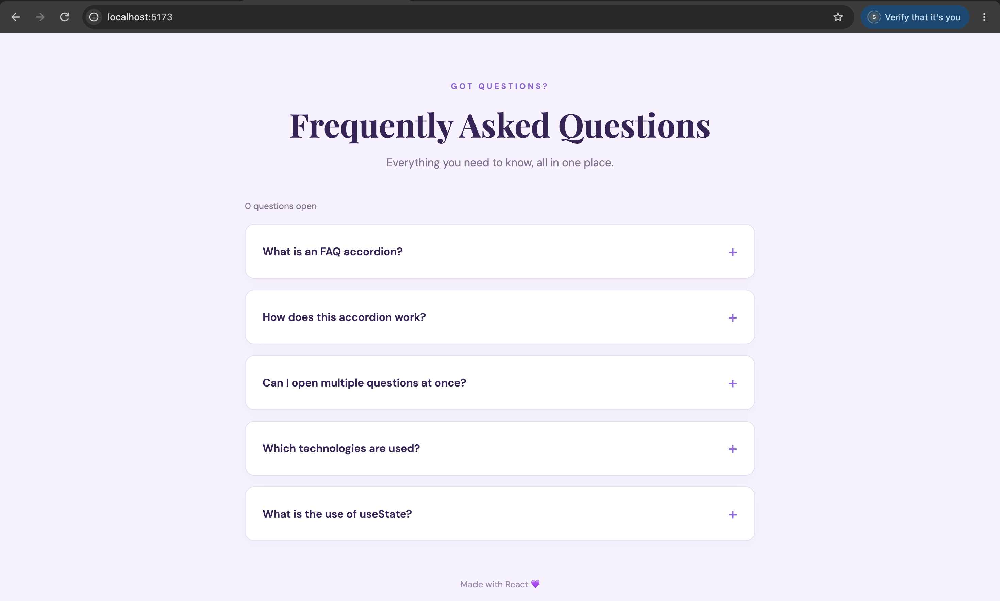

# FAQ Accordion

A responsive FAQ Accordion application built using React and Vite. Users can expand questions to read their answers, with only one question open at a time.

## Screenshot



## Features

- Displays five frequently asked questions.
- Opens one question at a time.
- Automatically closes the previously opened question when another is selected.
- Clicking an already-open question closes it.
- Displays a plus (+) icon for closed questions and a minus (−) icon for the open question.
- Shows the number of currently open questions.
- Includes smooth expand and collapse transitions.
- Responsive design for mobile and desktop screens.

## Technologies Used

- React
- JavaScript
- JSX
- HTML5
- CSS3
- Vite

## Project Structure

```text
faq-accordion/
│
├── screenshots/
│   └── faq-accordion.png
│
├── src/
│   ├── assets/
│   │   ├── hero.png
│   │   ├── react.svg
│   │   └── vite.svg
│   │
│   ├── components/
│   │   └── Accordion.jsx
│   │
│   ├── App.jsx
│   ├── App.css
│   ├── index.css
│   └── main.jsx
│
├── index.html
├── package.json
├── package-lock.json
├── vite.config.js
└── README.md
```

## Installation and Setup

### 1. Clone the repository

```bash
git clone https://github.com/SnehaSujeesh10/faq-accordion.git
```

### 2. Navigate to the project folder

```bash
cd faq-accordion
```

### 3. Install dependencies

```bash
npm install
```

### 4. Start the development server

```bash
npm run dev
```

Open the local URL displayed in your terminal to view the application.

## Build for Production

To create a production build, run:

```bash
npm run build
```

## How It Works

The application uses React's `useState` Hook to keep track of the currently open question.

- `activeIndex` stores the index of the currently open question.
- `setActiveIndex` updates the state.
- `toggleFAQ()` handles opening and closing questions.
- `map()` displays the FAQ items dynamically.
- Conditional rendering changes the plus and minus icons depending on the question's state.

Only one question can remain open at a time.

## Author

**Sneha Sujeesh**

GitHub: [SnehaSujeesh10](https://github.com/SnehaSujeesh10)